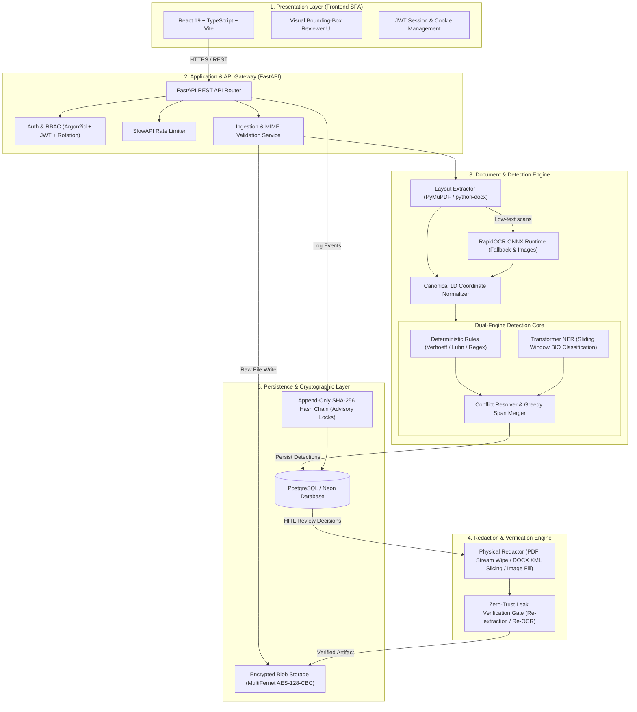
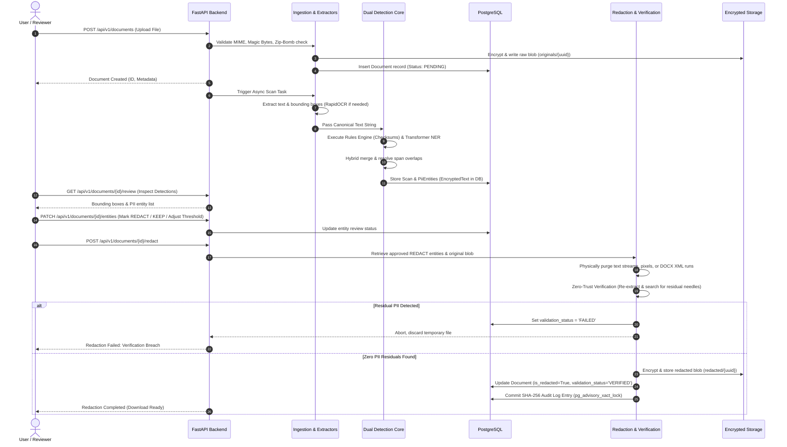
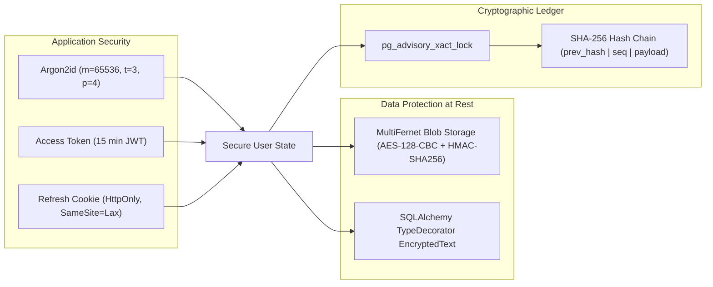
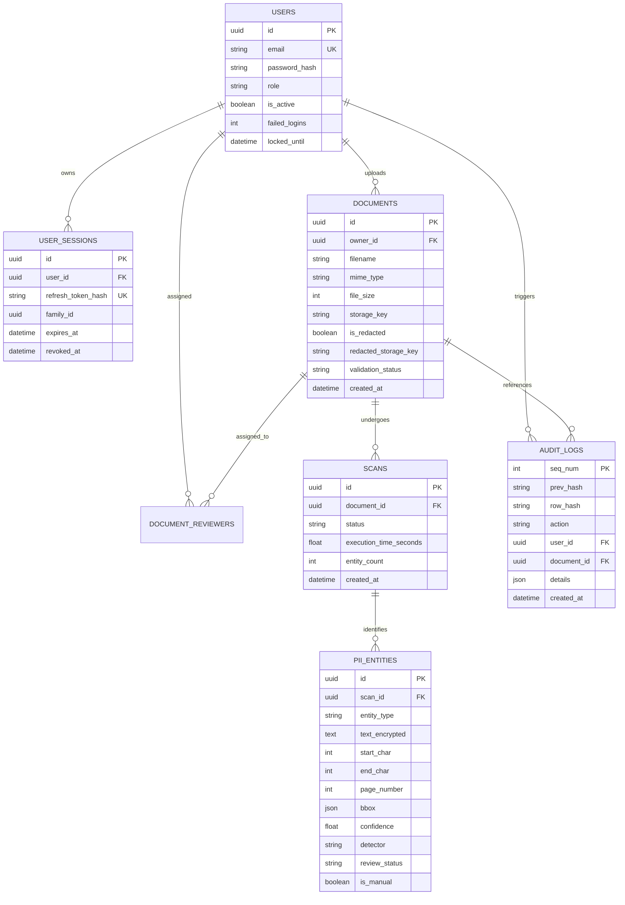
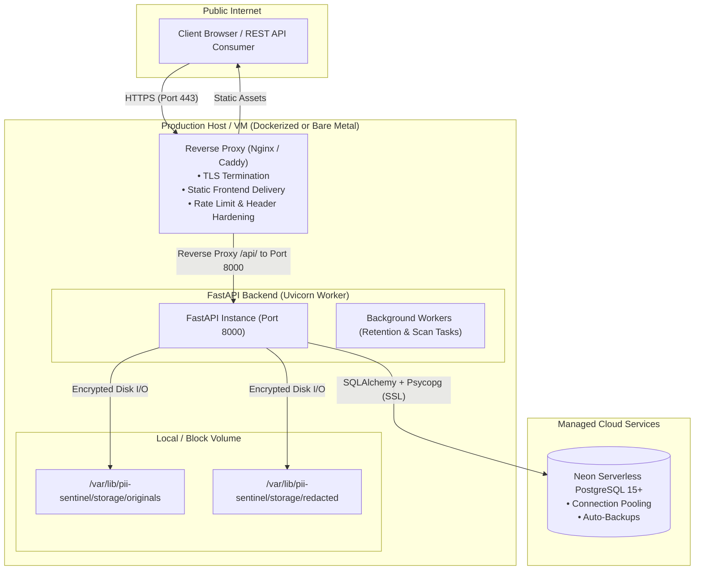

# Blur (PII Sentinel) — High-Level Design (HLD) Document

---

## 1. Executive Summary & Objective

**Blur** (internally *PII Sentinel*) is an enterprise-grade, privacy-first Personally Identifiable Information (PII) detection, review, and physical redaction platform. The system is designed to prevent data leakage in regulatory environments governed by frameworks such as the **Digital Personal Data Protection (DPDP) Act (India)**, **General Data Protection Regulation (GDPR, EU)**, and **HIPAA (US)**.

### Core System Objectives
1. **Multi-Format Ingestion**: Ingest and process structured and unstructured document formats (PDFs, DOCX, raster images, and plain text) with file integrity and zip-bomb protection.
2. **Hybrid Dual-Engine Detection**: Combine deterministic rule engines (with mathematical checksum validators like Verhoeff and Luhn) with deep learning sequence-labeling Transformer models (MiniLM / RoBERTa) via canonical coordinate normalization.
3. **Human-in-the-Loop (HITL) Workflow**: Support granular document review, reviewer delegation, threshold-based bulk triage, and manual span annotation.
4. **Permanent Physical Redaction**: Strip underlying vector text and raster pixels rather than merely superimposing visual masks.
5. **Zero-Trust Verification**: Enforce a post-redaction verification gate that re-extracts and re-OCRs files to ensure zero residual PII leaks before files are released.
6. **Cryptographic Accountability**: Maintain an append-only, SHA-256 hash-chained audit ledger guarded by monotonic database advisory locks.

---

## 2. System Architecture & Component Diagram

The platform follows a decoupled, three-tier architecture:
- **Presentation Tier**: Single Page Application (React 19 + TypeScript + Vite + Tailwind CSS) providing visual coordinate overlays and reviewer queues.
- **Application & Processing Tier**: FastAPI backend running asynchronous extractors, OCR workers, ML inference pipelines, and physical redaction engines.
- **Persistence & Storage Tier**: Relational storage (PostgreSQL / Neon) with field-level encryption, paired with an encrypted filesystem blob store.

---

## 3. End-to-End Data & Execution Lifecycle

---

## 4. Key Subsystem Specifications

### 4.1 Ingestion & Canonical Coordinate Mapping
* **File Validation**: Enforces magic-byte signature matching (`%PDF-`, `\x89PNG`, `\xff\xd8\xff`, ZIP package headers for DOCX). Enforces a 20 MB size limit and a 200-page limit.
* **Zip-Bomb Mitigation**: DOCX containers are audited before extraction, enforcing an uncompressed ceiling of 200 MB and a max of 5,000 internal file entries.
* **Canonical Coordinate Mapping**: Bounding boxes extracted from PyMuPDF or RapidOCR are mapped to character offsets `[start, end)` across a 1D normalized text stream. This cleanly decouples the layout extraction mechanics from downstream detection algorithms.

### 4.2 Dual-Engine Detection & Hybrid Conflict Resolution
The detection architecture mitigates false positives and false negatives through complementary paradigms:

| Engine | Technique | Target Categories | Key Strengths |
| :--- | :--- | :--- | :--- |
| **Deterministic Rules** | Regex + Mathematical Checksums | Aadhaar (Verhoeff), Credit Cards (Luhn), PAN, IFSC, Dates, Phone Numbers | 100% precision on structured identifiers; zero false positives from checksum verification. |
| **Transformer NER** | Deep learning token classification (`MiniLM` / `XLM-RoBERTa`) | Person Names, Organizations, Locations, Miscellaneous context spans | High recall across unstructured prose and noisy OCR transcriptions. |

#### Conflict Resolution Arbitration:
1. **Confidence Filtering**: Discard candidates below `MIN_CONFIDENCE` (default 0.3).
2. **Same-Type Union**: Overlapping detections of identical entity types are merged into their bounding union `[min(start), max(end)]`, taking the maximum score.
3. **Cross-Type Greedy Arbitration**: Overlapping spans of distinct types are prioritized by:
   $$\text{Priority} = (\text{Score}_{\text{desc}}, \text{Length}_{\text{desc}}, \text{MethodRank}_{\text{asc}}, \text{StartOffset}_{\text{asc}})$$
   *Deterministic rules (`MethodRank=0`) strictly supersede ML models on score ties.*

### 4.3 Human-in-the-Loop (HITL) Review Subsystem
* **Document Delegation**: Owners can delegate documents to `REVIEWER` and `ADMIN` accounts.
* **Tri-State Classification**: Entities can be triaged into `REDACT` (scrub), `KEEP` (whitelist), or `FALSE_POSITIVE` (incorrect detection).
* **Bulk Threshold Tuning**: Reviewers can set global confidence thresholds (e.g., *Redact all entities with confidence $\ge 0.85$*) with a dynamic re-apply flag to re-evaluate previously triaged spans.
* **Manual Annotations**: Reviewers can draw new spans directly onto the UI, creating `is_manual=True` entities.

### 4.4 Multi-Format Physical Redaction Engine
Redaction expunges underlying binary data rather than drawing superficial black masks:
* **PDF Documents**: Employs `fitz.apply_redactions(images=fitz.PDF_REDACT_IMAGE_PIXELS)`. Vector glyphs and raster image pixels beneath coordinates are permanently wiped from the PDF stream. Document metadata, annotations, and form streams are sanitized.
* **DOCX Documents**: Parses OpenXML DOM hierarchies, isolating `<w:t>` text runs. Spans are replaced with `[REDACTED]` or character-preserving masks while maintaining surrounding XML styles, fonts, and paragraph properties.
* **Raster Images**: Draws solid opaque fill blocks using Pillow and strips EXIF metadata.
* **Plain Text**: In-memory character replacement writing sanitized UTF-8 outputs.

### 4.5 Zero-Trust Post-Redaction Verification Gate
Before any output document is written to permanent storage:
1. The redacted output is reopened as an untrusted input.
2. The entire document is re-extracted (and re-OCRed where applicable).
3. The verification harness (`check_absent`) searches for every redacted needle.
4. If any sensitive string occurs more frequently than allowed, the file is immediately deleted, marked `FAILED`, and quarantined.

---

## 5. Security & Cryptographic Architecture

1. **Authentication & Session Hardening**:
   - Passwords hashed using **Argon2id** with timing-equalized verification (`burn_verify`) to block username enumeration.
   - Dual-token model: 15-minute JWT access tokens paired with high-entropy (48-byte) rotating refresh tokens stored exclusively as SHA-256 hashes.
   - Reuse/theft detection invalidates the entire session family if an expired refresh token is reused outside the 10-second grace window.
2. **Dual-Layer Encryption at Rest**:
   - Filesystem blobs are encrypted with `MultiFernet` (AES-128-CBC with HMAC-SHA256 authenticated encryption) marked with a `PIISENC1` header.
   - Database PII entities and sensitive fields are encrypted transparently in PostgreSQL using `EncryptedText` SQLAlchemy decorators.
3. **Tamper-Evident SHA-256 Audit Chain**:
   - Each audit log row hashes the previous row's hash, sequence number, action, actor ID, document ID, details, and UTC timestamp:
     $$\text{Hash}_n = \text{SHA256}(\text{Hash}_{n-1} \parallel \text{Seq}_n \parallel \text{Action} \parallel \text{UserID} \parallel \text{DocID} \parallel \text{Timestamp})$$
   - Serialized via PostgreSQL transaction-level advisory locks (`pg_advisory_xact_lock(0x5049495F41554449)`) to guarantee strict monotonicity without lock contention or fork splits.

---

## 6. Database Schema Design (Entity-Relationship)

---

## 7. Infrastructure & Deployment Topology

---

## 8. Non-Functional Requirements (NFR) Matrix

| Dimension | Target Specification | Enforcement Mechanism |
| :--- | :--- | :--- |
| **Throughput & Limits** | Max 20 MB file size; max 200 PDF pages; max 2,000,000 extracted characters | Streaming byte chunk limits in FastAPI ingestion pipeline. |
| **API Rate Limiting** | Auth: `10/min`; Ingestion/Scans: `60/min` | SlowAPI rate limiter (in-memory or Redis-backed). |
| **Processing Latency** | $< 2.5\text{s}$ for 10-page text PDF; $< 15\text{s}$ for 10-page 200 DPI OCR scan | RapidOCR ONNX inference runtime + PyMuPDF C-level bindings. |
| **Security & Privacy** | Zero unencrypted storage at rest; zero plain text PII in databases | Dual-layer MultiFernet file encryption + SQLAlchemy EncryptedText columns. |
| **Reliability** | Self-healing scan worker queue; atomic file replacements | Atomic `os.replace` on `.part` files; DB scan transition locks with server reboot recovery. |
| **Compliance** | Full tamper-evident audit trails for DPDP, GDPR, HIPAA | SHA-256 append-only chained audit logs with PostgreSQL advisory lock serialization. |
